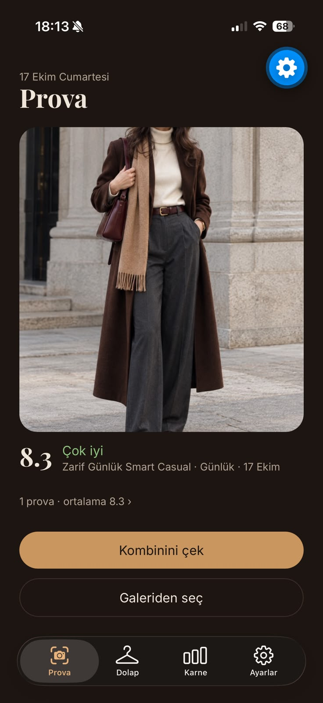
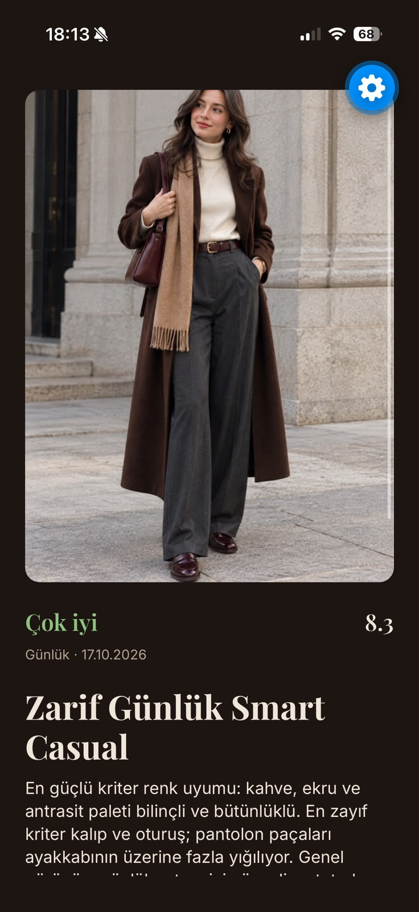
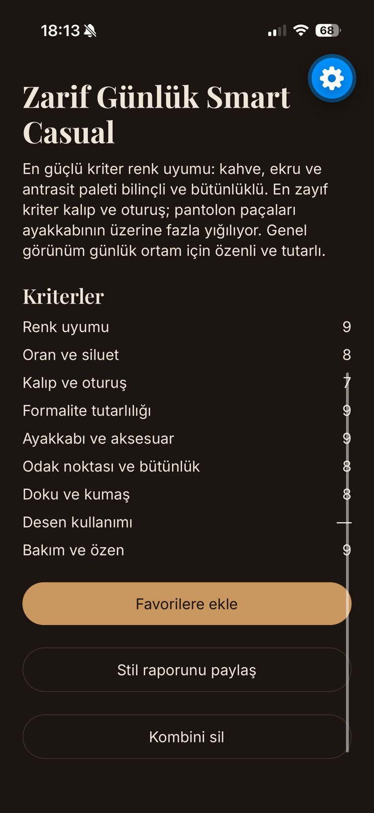
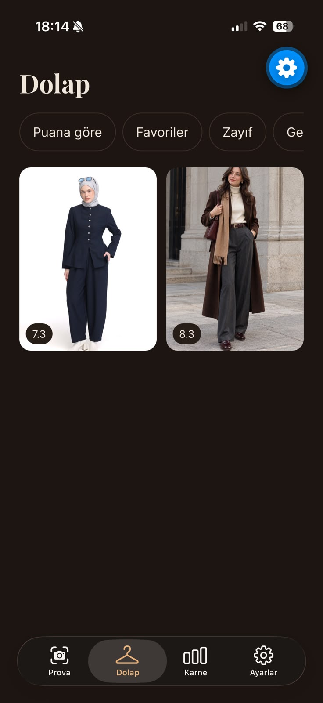
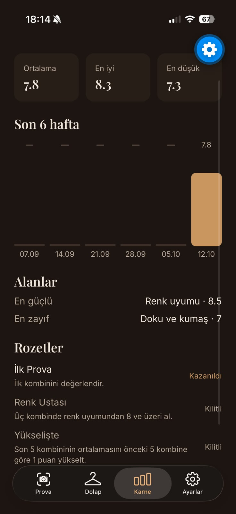
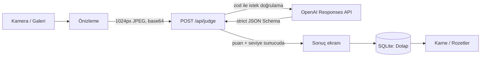

# Prova

Kombininin fotoğrafını çek; AI stil danışmanı moda ilkelerine göre kriter kriter puanlasın, seviyeni ve net bir stil raporu versin.
Mobile Application Development dersi final projesi (Expo + React Native). Canlı API: https://prova.expo.app

| Ana sayfa | Stil raporu | Kriterler | Dolap | Karne |
|---|---|---|---|---|
|  |  |  |  |  |

## Özellikler

- Kamera (ön/arka, 3-2-1 zamanlayıcı) veya galeriden fotoğraf; ortam seçimi: Günlük, İş, Davet, Spor
- 9 kriterde gözlem ve puan, 10 üzerinden toplam puan, seviye (Zayıf → Kusursuz), artılar, eksikler, öneriler
- Dolap: her değerlendirme cihazda saklanır; puan, favori ve seviye filtresi
- Karne: ortalama, haftalık grafik, kriter ortalamaları, rozetler
- Stil raporunu görsel olarak paylaşma, açık/koyu tema, günlük hatırlatma, ilk açılış tanıtımı
- Çevrimdışı uyarısı, ekran okuyucu etiketleri, büyük yazı desteği

## Mimari



- **API route** (`src/app/api/judge+api.ts`): EAS Hosting'de çalışır. OpenAI anahtarı yalnızca burada okunur, istemciye hiç gitmez. Cihaz başına dakikada 5 istek sınırı vardır.
- **Puanlama:** model yalnızca 9 kriteri puanlar. Toplam puanı sunucu hesaplar: ağırlıklı ortalama ve zayıf halka tavanı (`src/lib/ai/schema.ts`). Ağırlıklar: renk uyumu 20, oran ve siluet 15, kalıp ve oturuş 15, formalite 12, ayakkabı ve aksesuar 10, odak noktası 10, doku 8, desen 5 (desen yoksa hesaba girmez), bakım 5.
- **Yerel veri:** `expo-sqlite` (`prova.db`, `outfits` tablosu) ve fotoğraflar için `expo-file-system`. Ayarlar `expo-sqlite/kv-store`'da durur. Hesap ve bulut yok.

| Klasör | İçerik |
|---|---|
| `src/app/` | Ekranlar ve API route (expo-router) |
| `src/components/` | Yeniden kullanılan arayüz parçaları |
| `src/lib/` | AI şeması ve istemcisi, veritabanı, istatistik, rozet, hatırlatma mantığı |
| `src/constants/theme.ts` | Renk, boşluk ve yazı tokenları |
| `docs/` | Ürün tasarımı, sprint planı, test planı, demo akışı |

## Kurulum

```bash
npm install
cp .env.example .env   # OPENAI_API_KEY'i doldur ya da AI_MOCK=1 bırak
npx expo start
```

Telefonda Expo Go ile QR kodu okut (iPhone ve Android). Geliştirmede istekler bilgisayardaki dev sunucusunun API route'una gider.

| Değişken | Açıklama |
|---|---|
| `OPENAI_API_KEY` | Yalnızca sunucuda okunur; `EXPO_PUBLIC_` öneki asla verilmez |
| `AI_MOCK` | `1` iken OpenAI çağrılmaz, sahte karar döner |

## Komutlar

| İş | Komut |
|---|---|
| Geliştirme sunucusu | `npx expo start` |
| Tip kontrolü | `npx tsc --noEmit` |
| Lint | `npx expo lint` |
| Test | `npx jest` |
| API deploy | `npx expo export -p web` ardından `npx eas-cli deploy --prod --environment production` |

Production ortamında `OPENAI_API_KEY`, Expo panelinde "secret" ortam değişkeni olarak durur. Production derlemeler `app.json`'daki `origin` ile canlı API'ye bağlanır.
