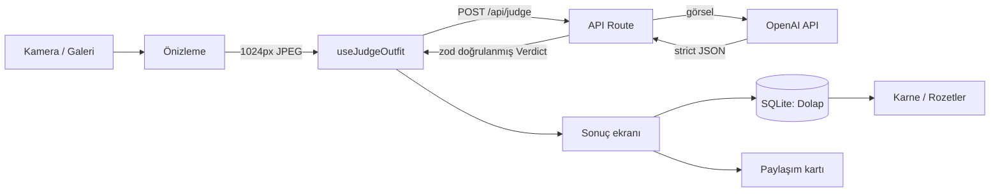

# Prova — Ürün ve Teknik Tasarım

> Kombininin fotoğrafını çek; yapay zekâ stil danışmanı moda ilkelerine göre kriter kriter puanlasın ve sert ama işe yarar bir stil raporu versin.
> Mobile Application Development final projesi · Expo + Claude Code skill'leri ile geliştirilir.

## 1. Ürün özeti

| Başlık | Karar |
|---|---|
| Fikir | Kombin fotoğrafını ve ortamı (Günlük / İş / Davet / Spor) gönder; 10 üzerinden puan (1 ondalık), seviye, başlık ("Dengeli Smart Casual"), stilist yorumu, 9 kriterin gözlem + puanı, artı/eksi, uygulanabilir öneriler |
| Puanlama | Model her kriteri önce gözlemle sonra 0-10 puanlar; toplamı sunucu hesaplar: ağırlıklı ortalama + zayıf halka tavanı. Kriterler (ağırlık): renk uyumu 20, oran ve siluet 15, kalıp ve oturuş 15, formalite tutarlılığı 12, ayakkabı ve aksesuar 10, odak noktası ve bütünlük 10, doku ve kumaş 8, desen kullanımı 5 (desen yoksa hesaba girmez), bakım ve özen 5 |
| Seviye | Zayıf · Geliştirilmeli · İyi · Çok iyi · Kusursuz |
| Değerlendirici | Tek stil danışmanı: ciddi ve net, ironi yok; eleştirisi sert ama yalnızca kıyafete, her eksiğe bir öneri |
| Veri | Sadece cihazda (SQLite + dosya sistemi), hesap yok |
| Platform | iOS + Android, Expo Go ile test |
| Kapsam dışı | Hesap/login, bulut senkron, App Store yayını, sosyal akış |

## 2. Teknik yığın

| Katman | Seçim | Neden |
|---|---|---|
| Çatı | Expo (create-expo-app@latest, TypeScript) | Ders gereksinimi |
| Yönlendirme | expo-router (tabs + stack) | Dosya tabanlı, API route desteği |
| Kamera / görsel | expo-camera, expo-image-picker, expo-image-manipulator, expo-image | Çekim, seçim, sıkıştırma, hızlı gösterim |
| AI | Expo Router API route → OpenAI Responses API (görsel + strict JSON Schema çıktısı) | Anahtar sunucuda kalır, JSON garantili |
| Doğrulama | zod (yalnızca sunucuda) | AI yanıtı ve gelen istek sistem sınırı olduğu için |
| İstek durumu | Basit `useJudgeOutfit` hook (useState) | Tek istek için kütüphane gereksiz |
| Yerel veri | expo-sqlite (+ kv-store), expo-file-system | Dolap ve ayarlar cihazda |
| Animasyon / his | react-native-reanimated, expo-haptics | Puan açılışı, seviye animasyonu |
| Paylaşım | react-native-view-shot, expo-sharing | Stil raporu kartı görseli |
| Bildirim | expo-notifications (yerel) | Günlük hatırlatma |
| Test / kalite | jest-expo (yalnızca `lib/` saf fonksiyonları), ESLint, tsc | `verify` skill'i her commit öncesi çalıştırır |
| Deploy | EAS Hosting (API), EAS Build (opsiyonel APK) | Demo günü gerçek URL |

## 3. Mimari

## 4. Ekranlar

| Ekran | Dosya | İçerik |
|---|---|---|
| Prova (sekme) | `app/(tabs)/index.tsx` | Çek / galeriden seç |
| Kamera | `app/kamera.tsx` | Silüet kılavuzu, ön/arka, 3-2-1 zamanlayıcı |
| Önizleme | `app/onizleme.tsx` | Ortam seçimi, tekrar çek / değerlendir |
| Sonuç | `app/sonuc.tsx` | Yükleme → puan açılışı → seviye → kriter dökümü → stil raporu |
| Dolap (sekme) | `app/(tabs)/dolap.tsx` | Kombin galerisi, filtre, favori |
| Kombin detay | `app/kombin/[id].tsx` | Geçmiş karar, favori, sil, paylaş |
| Karne (sekme) | `app/(tabs)/karne.tsx` | Haftalık grafik, en iyi/kötü, kriter ortalamaları, gelişim rozetleri |
| Ayarlar (sekme) | `app/(tabs)/ayarlar.tsx` | Tema, bildirim, veri temizle |
| Onboarding | `app/onboarding.tsx` | İlk açılışta 3 sayfa |
